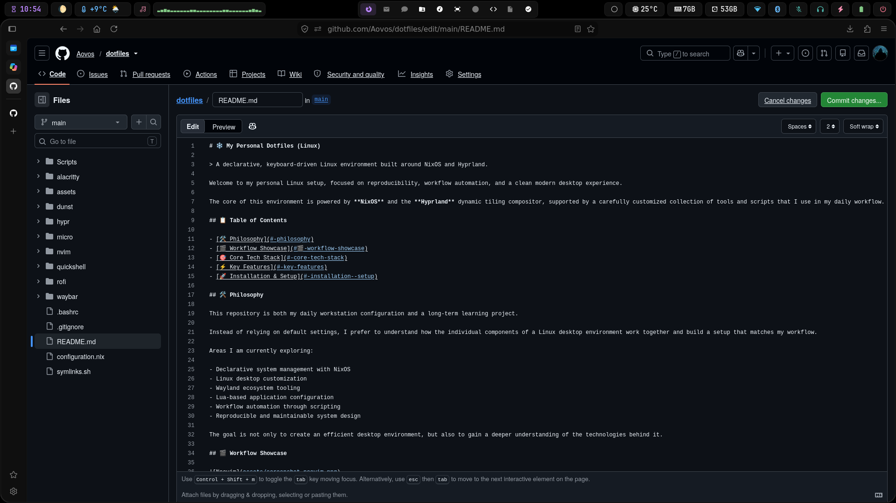
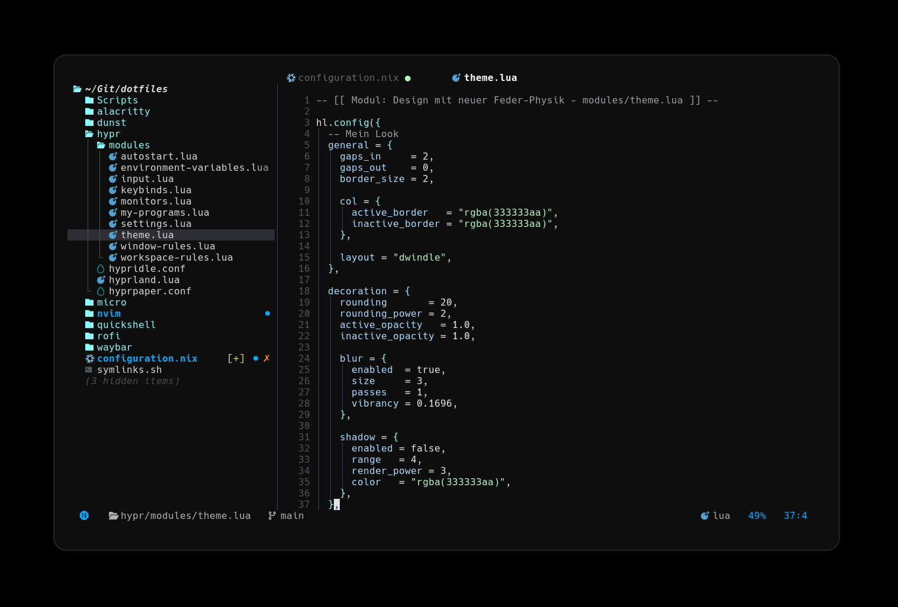
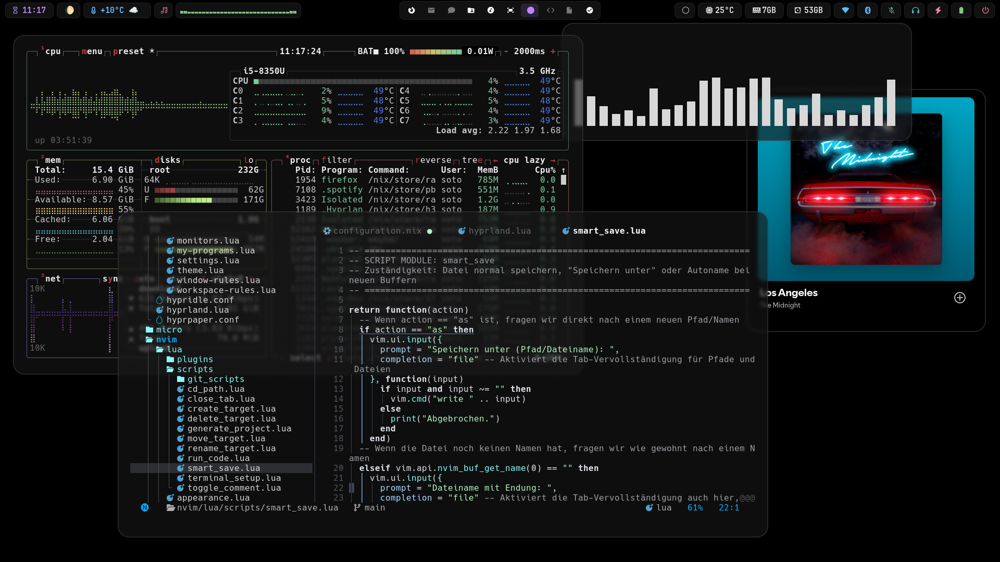

# ❄️ My Personal Dotfiles (Linux)

> A declarative, keyboard-driven Linux environment built around NixOS and Hyprland.

Welcome to my personal Linux setup, focused on reproducibility, workflow automation, and a clean modern desktop experience.

The core of this environment is powered by **NixOS** and the **Hyprland** dynamic tiling compositor, supported by a carefully customized collection of tools and scripts that I use in my daily workflow.

## 📋 Table of Contents

- [🛠 Philosophy](#-philosophy)
- [🎬 Workflow Showcase](#-workflow-showcase)
- [⚡ Components & Features](#-components--features)
- [🚀 Installation & Setup](#-installation--setup)

## 🛠 Philosophy

This repository is both my daily workstation configuration and a long-term learning project.

Instead of relying on default settings, I prefer to understand how the individual components of a Linux desktop environment work together and build a setup that matches my workflow.

Areas I am currently exploring:

- Declarative system management with NixOS
- Linux desktop customization
- Wayland ecosystem tooling
- Lua-based application configuration
- Workflow automation through scripting
- Reproducible and maintainable system design

The goal is not only to create an efficient desktop environment, but also to gain a deeper understanding of the technologies behind it.

## 🎬 Workflow Showcase




## ⚡ Components & Features

This setup combines a collection of tools and customizations designed around a focused, keyboard-driven workflow.

- **NixOS**
  Declarative system management, reproducible configurations and centralized package control.
- **Hyprland**
  A dynamic Wayland compositor used to build a workspace-driven workflow focused on context switching rather than multi-monitor setups.
- **Neovim**
  Lua-based editor configuration tailored for development, navigation and productivity.
- **Alacritty**
  Fast GPU-accelerated terminal emulator used as the primary interface for development and system management.
- **Waybar**
  Customized status bar featuring weather integration, workspace indicators, calendar previews, brightness controls and system monitoring.
- **Rofi**
  Central launcher for applications, scripts, power controls and everyday system interactions.
- **Dunst**
  Lightweight notification management that integrates seamlessly into the desktop environment.
- **Gaming & Performance**
  Integrated support for Steam, Gamemode and gaming-related system optimizations managed through NixOS.
- **Automation & Scripting**
  Custom scripts and deployment tools simplify repetitive tasks and provide additional desktop functionality.
- **Dotfile Deployment**
  Automated configuration management through custom symlink tooling for easy setup and maintenance.

## 🚀 Installation & Setup

> ⚠️ These dotfiles are tailored to my personal workflow and hardware. Review all configurations before applying them to your system.

### Clone the repository

```bash
git clone https://github.com/Aovos/dotfiles.git
cd dotfiles
```

### Deploy user configuration files

```bash
chmod +x symlinks.sh
./symlinks.sh
```

### Apply the NixOS configuration

```bash
sudo nixos-rebuild switch
```
